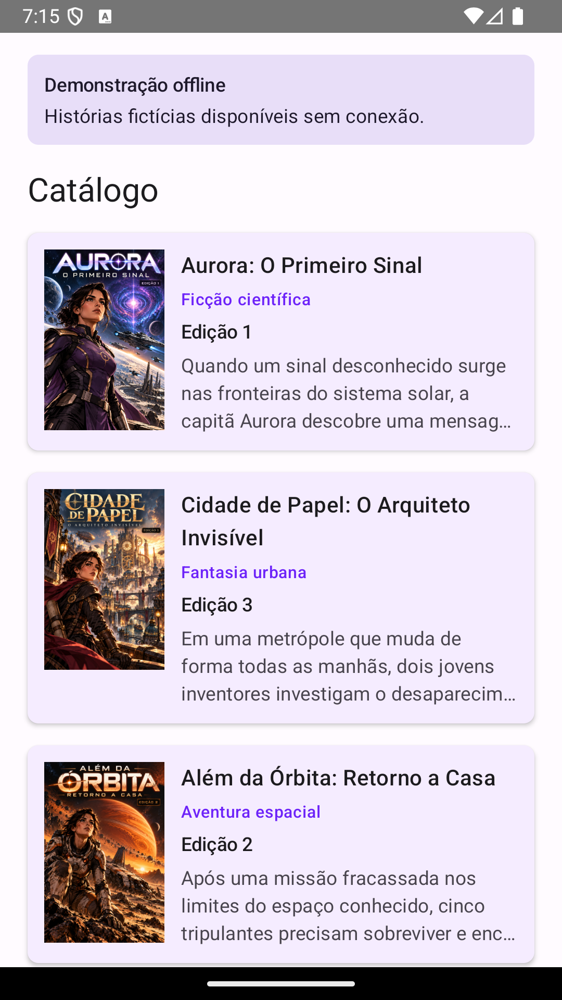
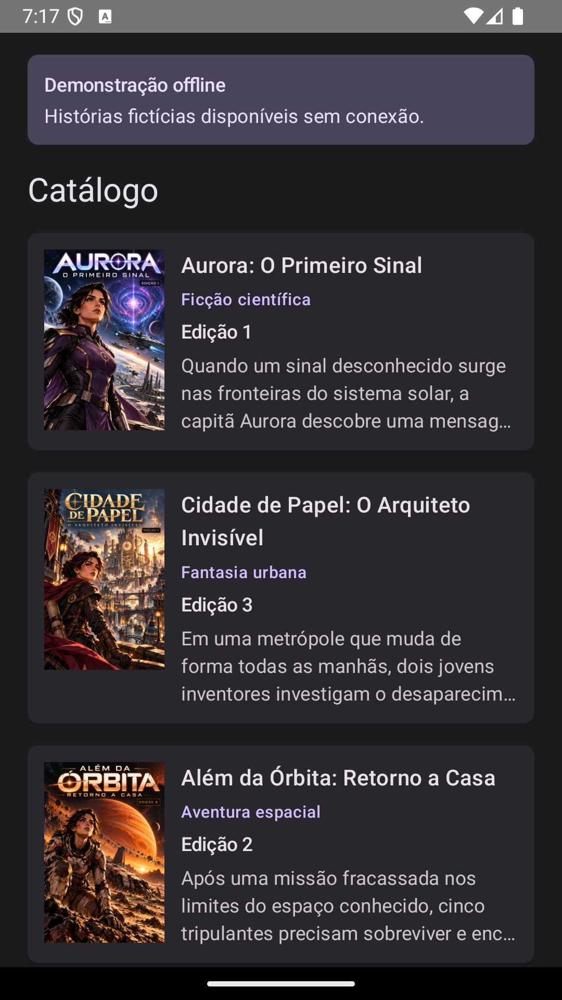
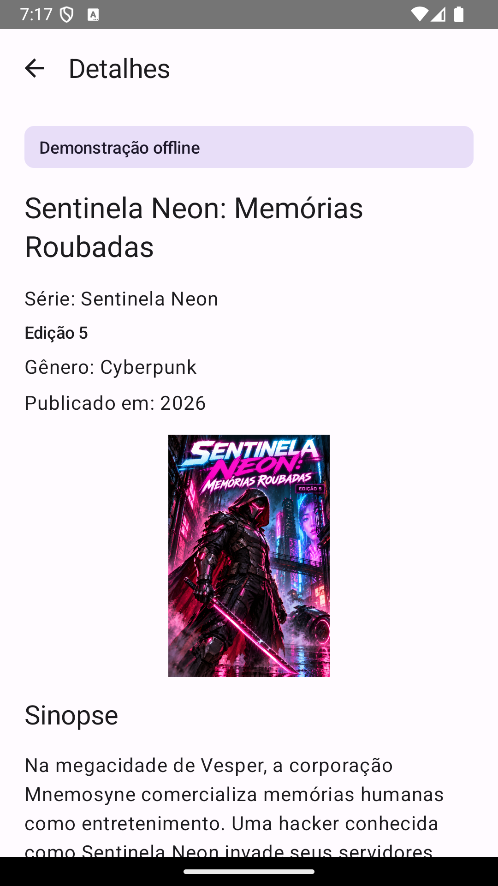
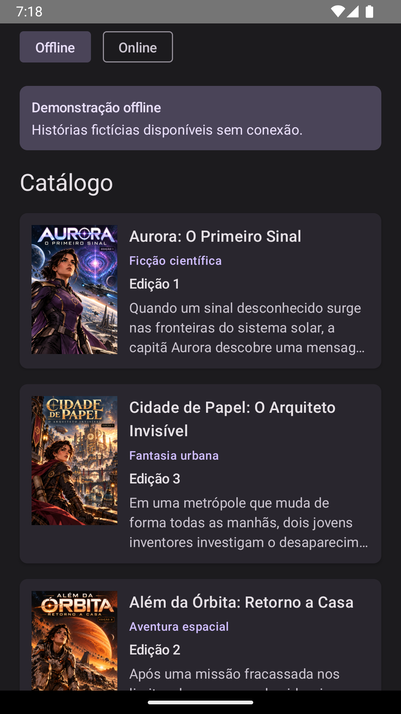
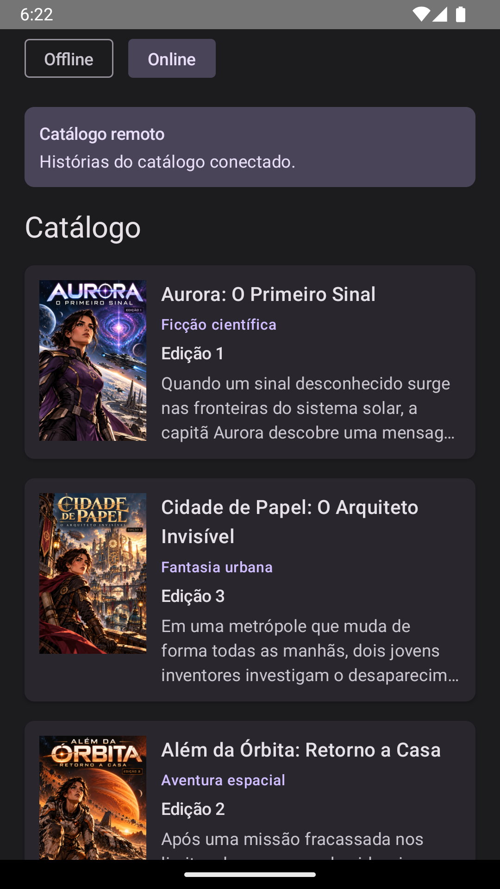
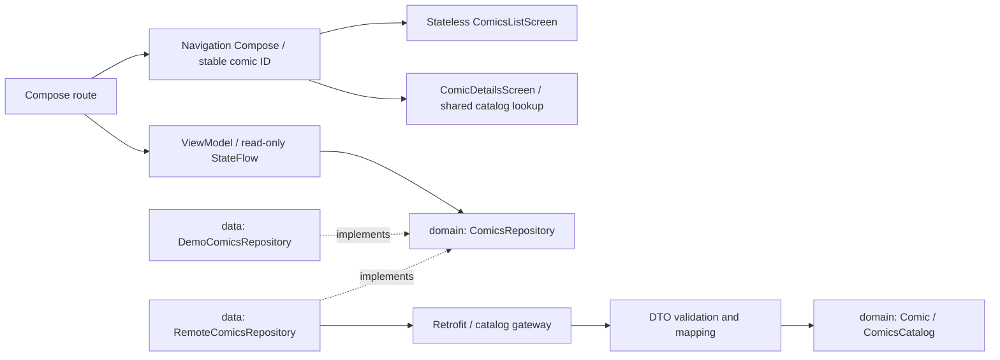

# Comics · Android Engineering Showcase

A deliberately small Android sample for discussing architecture, concurrency, UI state,
security boundaries and reproducible validation in senior engineering interviews.
It is a reviewable engineering exercise, not a production-readiness claim.

The app starts with an **offline demo** containing six fictional comics and bundled cover
images. Select Online to load nine comics from Railway, including three API-exclusive
stories at the top with remote covers. The six shared comics retain their bundled artwork.
Neither mode requires credentials or Marvel calls. The existing
story fixtures are fictional Portuguese text; the interface is in Portuguese; this project guide is in English.

## What the app demonstrates

- A Compose catalog with six local covers, metadata, loading, content, empty and recoverable error states.
- Clickable cards, ID-based detail navigation, full synopses and working back navigation.
- Explicit demo identification and retry without overlapping requests.
- Material 3 light/dark themes, scrollable status screens and content-driven card heights.
- Lifecycle-aware state collection, read-only StateFlow and cancellation-safe loading.
- Pure Kotlin domain contracts, validated remote DTOs and replaceable repositories.
- Optional HTTPS catalog integration and a separate restricted image transport.
- Behavioral JVM tests, isolated Compose tests and a GitHub Actions workflow.

There are no search, favorites, login, persistence or paging features.

## Screenshots

Real screenshots captured by the maintainer in the Android Studio emulator on Windows.
The interface is in Portuguese. The four original captures below show the Offline demo;
the two final comparison captures show the six-item Offline catalog and the nine-item
Online catalog, including API-exclusive stories with remote covers.

<table>
  <tr>
    <td align="center"><br><b>Offline catalog · Light</b></td>
    <td align="center"><br><b>Offline catalog · Dark</b></td>
  </tr>
  <tr>
    <td align="center"><br><b>Aurora details · Dark</b></td>
    <td align="center"><br><b>Sentinela Neon details · Light</b></td>
  </tr>
</table>

See the [Windows emulator capture guide](docs/screenshots/README.md) to reproduce these
screens. Images retain their full 1080 × 1920 resolution; display widths only affect the
gallery layout. These captures do not establish behavior on every device or accessibility setting.

### Offline vs. Online

Both captures were taken on the same Android emulator at 1080 × 1920.
**Offline** uses six bundled fictional comics and local WebP covers, without a backend
request. **Online** loads nine comics from the public Railway API: three exclusive
stories appear first with remote covers, followed by the six shared comics with bundled
WebP artwork. The exclusive stories are Protocolo Ômega: Última Transmissão,
Distrito Neon: Código Fantasma and O Reino das Cinzas: Herdeira do Fogo.

<table>
  <tr>
    <td align="center"><br><b>Offline · Bundled catalog</b></td>
    <td align="center"><br><b>Online · Railway API</b></td>
  </tr>
</table>

These screenshots show the selected source and rendered catalog; they do not
by themselves prove network transport. The remote integration is covered by
the implementation and tests.

## Offline catalog and covers

All six fictional comics use the supplied Portuguese story text and publication year 2026:

| ID | Title | Edition | Local cover key |
| --- | --- | --- | --- |
| 1 | Aurora: O Primeiro Sinal | Issue 1 | `aurora` |
| 2 | Cidade de Papel: O Arquiteto Invisível | Issue 3 | `cidade_papel` |
| 3 | Além da Órbita: Retorno a Casa | Issue 2 | `alem_orbita` |
| 4 | Sentinela Neon: Memórias Roubadas | Issue 5 | `sentinela_neon` |
| 5 | Crônicas do Eclipse: O Último Guardião | Volume 1; no issue supplied | `eclipse` |
| 6 | O Vigilante das Sombras: Caso Zero | Issue 1 | `vigilante` |

Compact catalog cards place the cover on the left and title, genre, edition and a maximum
three-line summary on the right. Titles and metadata can wrap as fonts grow. Details use
a compact top app bar with an accessible back icon, show title/metadata first and cap the
cover height at 200dp before the full synopsis. Demo identification remains visible.

`ComicCover.kt` maps domain-neutral keys to `drawable-nodpi/cover_*.webp` only in `:app`.
Bundled images take precedence over remote URLs; demo records have no URLs, so rendering
never requires image downloads. Both resource IDs and remote URLs use Coil with IO fetch/decode
dispatchers. Coil Compose resolves the finite cover constraints for sampled decoding rather
than requesting the original bitmap size; memory caching is retained. Unknown keys fall back to the secure remote image loader
or an accessible placeholder. Known local image ratios come from presentation-only dimensions;
remote ratios update from a successful Coil painter (2:3 is only the unknown-image fallback).
`ContentScale.Fit` preserves the full artwork, titles and credits. Catalog covers fit within
88dp × 132dp and detail covers within 280dp × 200dp, with the full original aspect ratio preserved. Card text can grow and details/status content scroll; back targets remain 48dp.

The current six covers were generated with AI specifically for the fictional catalog,
as reported by the owner, and supplied as genuine 1024 × 1536 PNGs. All use 2:3 ratios.
Lossless WebP preserves every decoded RGB pixel without cropping, resizing or removing
credits: 15,964,404 source bytes become 12,165,196 bytes (23.80% reduction).
The corrected Sentinela, Eclipse and Vigilante covers now match the catalog titles and
edition/volume labels; the other three resource files are unchanged.
This is encoded-resource size, not a measured runtime/heap improvement. The historical
six-cover comparison measured smaller lossy JPEG/WebP candidates; those measurements do
not describe the three corrected sources. Lossless conversion preserves text and detail exactly.
See [current metrics](docs/cover-assets-metrics.json) and
[validation and historical record](docs/cover-hardening-validation.md).
[Provenance and licensing limits](docs/image-licensing.md) remain separate from technical validation.
Old images remain in Git history; replacing current resources does not erase that history.

## Stack

| Area | Current choice |
| --- | --- |
| Language / build | Kotlin 1.9.0, Gradle 8.2, Android Gradle Plugin 8.2.2, JDK 17 |
| Android | minSdk 21, compileSdk/targetSdk 34, Build Tools 34.0.0 |
| UI | Jetpack Compose BOM 2023.08.00, compiler 1.5.1, Material 3, Navigation Compose 2.7.7 |
| State / concurrency | ViewModel, StateFlow, Coroutines 1.7.3, lifecycle-compose 2.7.0 |
| Dependency injection | Hilt 2.50 with kapt |
| HTTP / images | Retrofit 2.9.0, Gson 2.10.1, OkHttp 4.12.0, Coil 2.5.0 |
| Tests | JUnit 4, kotlinx-coroutines-test, MockWebServer, Compose UI Test |

The Phase 1 toolchain is intentionally retained. A coordinated dependency/toolchain update
is a separate decision rather than an incidental part of the UI and CI work.

## Quick Start

Prerequisites: **JDK 17**, Android Studio with Android SDK Platform 34, Build Tools
34.0.0 and Platform Tools installed. Use an Android API 21+ emulator/device; the
existing automated emulator suite uses API 34. Gradle 8.2 is supplied by the checked-in
wrapper, so a separate Gradle installation is unnecessary. The first build needs
Internet access for Gradle/dependencies; Offline catalog operation needs no backend.

Clone the repository:

```bash
git clone https://github.com/jSantini/comics_sample.git
cd comics_sample
```

Open the repository root in Android Studio. Select JDK 17 under
`Settings > Build, Execution, Deployment > Build Tools > Gradle > Gradle JDK`, wait for
Gradle sync, then Run `app` on an emulator/device. SDK discovery can use Android Studio's
ignored `local.properties` (`sdk.dir`) or the standard `ANDROID_HOME` environment variable.
No owner-specific paths, Marvel keys, secrets or local backend are required. Do not copy
another developer's local.properties or user Gradle configuration.

For terminal builds, JAVA_HOME must point to your JDK 17 and ANDROID_HOME to your installed
SDK (or use an ignored local.properties). Check the JVM shown by the wrapper:

**Linux / macOS**

```bash
./gradlew --version
./gradlew :app:assembleDebug testDebugUnitTest
./gradlew :app:installDebug
```

**Windows PowerShell**

```powershell
.\gradlew.bat --version
.\gradlew.bat :app:assembleDebug testDebugUnitTest
.\gradlew.bat :app:installDebug
```

`installDebug` requires a running emulator or authorized device (`adb devices`). Launch
**Comics** after installation. It starts in **Offline**, with six bundled stories/covers.
Tap **Online** to load nine comics from Railway, including three exclusive stories at
the top with remote covers; no extra configuration is needed.
The four original README screenshots retain their Offline provenance; the comparison
section also includes a newer Online capture.

For a build with no configured backend, append `-PCOMICS_BASE_URL=` to the assemble/install
command on either platform. Offline stays functional; selecting Online then shows a
recoverable error. Online also requires connectivity and Railway availability.
The debug APK is `app/build/outputs/apk/debug/app-debug.apk`.

### Conditional Windows KAPT troubleshooting

If `:data:kaptGenerateStubsDebugKotlin` fails with
`IllegalAccessError: KaptJavaCompiler cannot access com.sun.tools.javac.main.JavaCompiler`,
first verify JDK 17 in both `gradlew --version` and Android Studio's Gradle JDK. The IDE
and terminal can otherwise launch Gradle with different JDKs. Inspect personal Gradle
properties or JVM-option overrides before assuming a repository defect.

The owner reported resolving this specific Windows error with JDK 17 and in-process
Kotlin compilation. If the same error persists with JDK 17, try the workaround for that
invocation only:

```powershell
.\gradlew.bat --no-daemon :app:assembleDebug testDebugUnitTest -Pkotlin.compiler.execution.strategy=in-process
```

The equivalent Linux/macOS syntax is `./gradlew` followed by the same arguments.
This is a conditional diagnostic workaround, not a universal prerequisite. Do not add
it globally or change tracked gradle.properties merely to reproduce an owner's setup.
Record the JDK, original error and results with/without it when reporting a build issue.

Run only one build/URL verification process at a time in a checkout. Additional lint,
URL-security and instrumented-test commands remain in [Tests and reproducible checks](#tests-and-reproducible-checks).

## Architecture



| Module | Responsibility | Dependencies |
| --- | --- | --- |
| `:domain` | Kotlin/JVM models, repository contract and failure categories | Kotlin only |
| `:data` | Fictional demo, remote DTOs/mapping, Retrofit repository and Hilt providers | `:domain` |
| `:app` | Composition, route/ViewModel, presentation state, screen, previews and image client | `:domain`, `:data`, `:component` |
| `:component` | Small shared Material 3 components | Android / Compose |

The app references data for Hilt composition, while presentation behavior depends on the
domain repository contract. Transport DTOs, domain models and UI items are separate.

A catalog load is a one-shot `suspend` operation. A pass-through use-case class or cold
Flow adds no rule here, so neither is introduced. The ViewModel owns UI state, propagates
cancellation and ignores another load while its current job is active. Completed/failed
loads can be retried. This is MVVM with unidirectional data flow, without an MVI framework.

Navigation Compose 2.7.7 stays in `:app`, with a catalog destination and `comic/{comicId}`.
Only the numeric ID crosses destinations. An activity-scoped ViewModel provides the already
loaded catalog; opening/backing out of details makes no additional repository request.
The NavController restores the destination/ID after recreation; the ViewModel survives
configuration changes. After process death the catalog reloads once through normal startup,
then resolves the restored ID. Missing/malformed/unavailable IDs have a safe return path;
loading/error states remain explicit. There is no persistent cache for remote data.

Room/DataStore/Paging and extra feature modules are deliberately absent.

## Offline and Online catalog

The app starts in **Offline**, using `DemoComicsRepository` without a network request.
Select **Online** to load nine comics through `RemoteComicsRepository` from the deployed
[Railway API](https://comics-showcase-api-production.up.railway.app/api/comics). Three
API-exclusive stories appear first with remote covers; the six embedded stories follow
and retain their matching bundled WebP artwork.
Backend source: [jSantini/comics-showcase-api](https://github.com/jSantini/comics-showcase-api).

The public default `COMICS_BASE_URL` is
`https://comics-showcase-api-production.up.railway.app/api/`. Build and install:

```bash
./gradlew :app:installDebug
# Then tap Online in the catalog.
# Explicit production configuration:
./gradlew :app:installDebug -PCOMICS_BASE_URL=https://comics-showcase-api-production.up.railway.app/api/
# Offline-only build, with no configured backend:
./gradlew :app:installDebug -PCOMICS_BASE_URL=
```

With an empty URL, Offline remains fully functional; Online shows a recoverable network
error. There is no silent fallback, persistent cache or automatic retry. Retry reloads the
selected source. Switching sources cancels the previous load and immediately clears its
items; cancellation is checked before publishing results or failures. A source indicator
is visible during loading, content, empty and error states. Selection survives Activity
recreation in the retained ViewModel, and resets to Offline after process death.

### Verified API contract

`GET comics` returns `{"data":{"results":[...]}}`. `data.results` is required; `[]` is
valid. Each entry requires a positive unique integer `id` and a nonblank `title`.
Optional nullable fields are `description`, `series`, `issueNumber`, `volumeNumber`,
`genre`, `publicationYear`, `shortSynopsis`, `synopsis` and `coverKey`. Numbers, when
present, must be positive. Missing synopses fall back to description; missing metadata
stays null. DTO, domain and UI models remain separate. Invalid JSON, missing required
fields and duplicate IDs become recoverable errors.

The checked-in `data/src/test/resources/railway-comics.json` is the earlier six-item
production snapshot captured on 2026-11-03 and retained for deterministic tests. It
contains IDs 1–6, issues 1/3/2/5 for IDs 1–4, **volume 1** for ID 5, and issue 1 for
ID 6. Its metadata and story text match the embedded catalog; it is not a snapshot of
the current nine-item live catalog.

The live API now returns exclusive IDs 7, 8 and 9 first, followed by the six shared
comics. The shared entries supply cover keys for the local WebPs. The exclusive entries
omit coverKey and provide HTTPS `thumbnail: {path, extension}` values for remote covers.
Unknown/invalid covers retain the existing secure image/placeholder fallback.

Automated network tests use MockWebServer and this local fixture; CI does not contact
Railway. Online use requires connectivity and backend availability. The four original screenshots
remain Offline captures; the newer comparison pair shows both source selections.

### URL and image security boundaries

- Base URLs require HTTPS, an ASCII/IPv6 host, optional port 1–65535 and a trailing slash;
  userinfo, query and fragment are rejected. Invalid raw URI characters require percent-encoding.
- BuildConfig literals are explicitly escaped. Unicode paths and encoded characters are
  round-trip checked against the actual generated Java. The URL remains **public in the APK**:
  never put a token in its path or in Gradle properties.
- Catalog calls use normal TLS trust, timeouts, no redirects and no request/response logging.
- DTO mapping drops image URLs with HTTP, userinfo, query, fragments or non-HTTP schemes.
- Coil uses the Application ImageLoader factory with a separate HTTPS-only client. Image
  requests do not share catalog authentication and do not follow redirects, even on the
  same host. Failures fall back to a local placeholder with an accessible unavailable label.

CDNs requiring redirects or signed query URLs are unsupported. There is no host allowlist,
private-IP filtering, certificate pinning or image proxy. A trusted gateway must select
appropriate image origins; HTTPS alone does not establish reputation or privacy. Local
Coil fetchers are unchanged, but the catalog does not accept arbitrary user-supplied URIs.

Provider availability, API terms, attribution, image licenses and server-side abuse limits
must be reviewed before using a real service. The public Railway response contract was verified; availability is not guaranteed.
Historical credentials removed in Phase 1 remain in Git history; rotation/revocation belongs
to the repository owner. They are not needed by the demo or CI.

## Current Railway integration validation

See [Railway integration validation](docs/railway-integration-validation.md) for the changed
files, exact contract, commands and limitations. On 2026-11-03: 47 JVM tests passed;
lint reported 0 errors and 34 warnings; app/test APK compilation passed; all 20 URL checks
passed. That initial local instrumented attempt was blocked by emulator/ADB communication.
Subsequent GitHub [run 41658203476](https://github.com/jSantini/comics_sample/actions/runs/41658203476)
for `d2027b0` completed successfully in both jobs; official logs confirm 43 instrumented
tests and a successful connected-test task. Separately, the owner reports 43 instrumented
tests passed on Windows and visually checked the live Online catalog. Those Windows/visual
checks were not rerun in the final review. The original four screenshots remain Offline captures; the new comparison pair includes Online.

See the [final integration review](docs/final-integration-review.md) for the evidence matrix
and two-stage PR plan, and the [sanitized security audit](docs/security-history-audit.md)
for current-tree versus historical exposure. Historical provider status is unverified;
previous artwork and a non-expired old APK artifact remain accessible at review time.
These documents record the reviewed code snapshot; documentation publication does not authorize a merge.

## Tests and reproducible checks

```bash
# Fresh debug build, JVM suites and static analysis
./gradlew --no-daemon --max-workers=2 clean :app:assembleDebug \
  testDebugUnitTest :domain:test :app:lintDebug :data:lintDebug :component:lintDebug \
  :app:assembleDebugAndroidTest -PCOMICS_BASE_URL=

# Real Gradle generation + javac/java URL round-trips and invalid-input guards
python3 scripts/verify_catalog_url.py

# Requires a running emulator or connected device (not just the SDK)
./gradlew --no-daemon --max-workers=2 :app:connectedDebugAndroidTest -PCOMICS_BASE_URL=
```

The URL script requires Python 3/JDK 17/SDK, uses public URL fixtures, removes its
temporary Java classes and restores an explicitly empty (offline-only) BuildConfig in `finally`.

The Phase 1 JVM suites cover DTOs, repository/HTTP behavior, cancellation, ViewModel/retry,
concurrent-load suppression and image transport/TLS. Test certificates are generated in
memory; production TLS is not relaxed. They do not test Android image decoding.

The isolated Compose screen/navigation tests inject states/callbacks directly, without Hilt
test injection, a ViewModel, a backend or remote image URLs. They cover loading, content, demo/remote identity, empty/error recovery,
retry transitions, a minimum 48dp retry control, scrolling and 2x text in dark mode.
Additional tests cover the supplied six-comic metadata/text, Android cover mapping,
ID selection, card callbacks, details, optional remote metadata, volume/issue distinction,
invalid IDs, both back paths, saved destination restoration and large-font dark details.
Integration tests add an Activity-owned real ViewModel, fake Repository call counter and
real NavHost, including Activity recreation and ID lookup while a catalog load is pending.
Cover pipeline tests inject an ImageLoader to verify source precedence/failures without
external HTTP; a wrapped bitmap decoder checks off-main execution and sampled resource size.
A legacy context test also remains. Compiling these tests is not executing them.

See [Visual refinement validation](docs/visual-refinement-validation.md),
[Cover/integration hardening validation](docs/cover-hardening-validation.md),
[Catalog and details validation before hardening](docs/catalog-details-validation.md),
[Phase 2 evidence and limitations](docs/phase-two-validation.md),
[Phase 1 evidence](docs/phase-one-validation.md) and
[URL/image hardening evidence](docs/review-hardening-validation.md).
No coverage percentage, device result or performance metric is implied by this README.

## GitHub Actions

`.github/workflows/android.yml` is configured for code PRs and pushes to `master`, `main`
and `modernization/phase-one`, plus manual dispatch. Documentation-only changes are ignored.

- `verify`: JDK 17, SDK 34, Gradle cache, URL checks, clean debug build, JVM tests, lint and
  instrumented APK compilation. Test/lint reports and debug/test APKs are retained for 7 days.
- `compose`: Android 34 x86_64 emulator with KVM; runs `:app:connectedDebugAndroidTest`
  and uploads instrumented results. It depends on a successful `verify` job.
- Actions are pinned to immutable commits; permissions are `contents: read`, checkout does
  not persist credentials, and PR Gradle caches are read-only. No provider secrets are used.
- Demo is explicitly selected. Jobs never call a real catalog. Dependency/SDK/emulator
  downloads still need Internet. Emulator-host availability can prevent the UI job from running.

Local workflow validation does not establish a successful GitHub run. Check the Actions
page for the specific review commit; artifacts only exist after an actual run. See the current integration validation above for local
Compose execution results. There are no release, signing, deployment
or merge steps.

## UI previews and manual checks

Open `ComicsListPreviews.kt` in Android Studio for loading/content/empty/error previews
and detail previews in light, dark and 2x-font configurations. All preview stories are fictional and have no
remote image URLs. Cards grow with text; status content and lists can scroll. Semantics
provide headings, a labeled progress indicator and recovery controls. Rendered covers are
decorative next to their title; unavailable placeholders have a label.
TalkBack, visual contrast, device rendering and accessibility still require manual review.

The six real emulator captures are shown in [Screenshots](#screenshots), including the
[Offline vs. Online comparison](#offline-vs-online).
Large-font and recovery-state visual/accessibility checks remain separate manual checks;
the gallery is not evidence that every device or accessibility configuration was reviewed.

No mock screenshots, fabricated imagery, CI badges or performance numbers are used.

## Review and scope

All changes follow the Human-Governed Engineering Protocol. Architectural ownership,
acceptance and approval remain with the maintainer. Existing Git authorship and Codex
assistance attribution are preserved. PR #1 integrates `feature/offline-comics-details`
into `modernization/phase-one`; only after that approved integration should a separate
Phase One to `master` PR be opened. Both merges require explicit approval. Historical
provider configuration and artwork handling remain owner decisions. No merge, history
rewrite or toolchain upgrade is performed by the final review.
