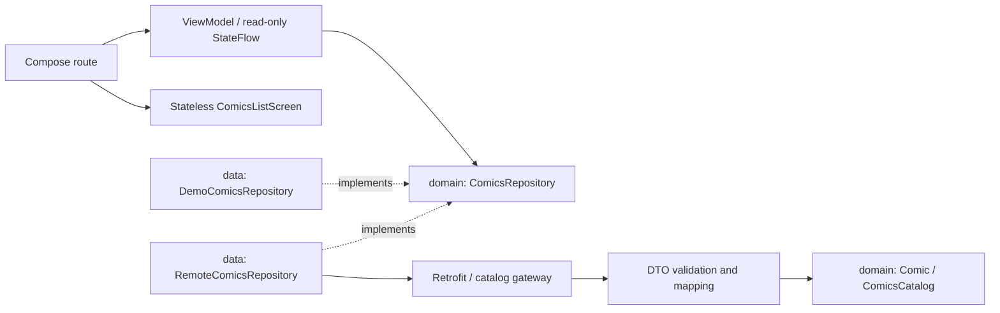

# Comics · Android Engineering Showcase

A deliberately small Android sample for discussing architecture, concurrency, UI state,
security boundaries and reproducible validation in senior engineering interviews.
It is a reviewable engineering exercise, not a production-readiness claim.

The default app is an **offline demo** containing three fictional stories and local cover
placeholders. It does not call Marvel, require credentials, or download images. The existing
story fixtures are fictional Portuguese text; the interface and project guide are in English.

## What the app demonstrates

- A single Compose catalog with loading, content, empty and recoverable error states.
- Explicit demo identification and retry without overlapping requests.
- Material 3 light/dark themes, scrollable status screens and content-driven card heights.
- Lifecycle-aware state collection, read-only StateFlow and cancellation-safe loading.
- Pure Kotlin domain contracts, validated remote DTOs and replaceable repositories.
- Optional HTTPS catalog integration and a separate restricted image transport.
- Behavioral JVM tests, isolated Compose tests and a GitHub Actions workflow.

There are no details, search, favorites, login, persistence, paging or navigation features.

## Stack

| Area | Current choice |
| --- | --- |
| Language / build | Kotlin 1.9.0, Gradle 8.2, Android Gradle Plugin 8.2.2, JDK 17 |
| Android | minSdk 21, compileSdk/targetSdk 34, Build Tools 34.0.0 |
| UI | Jetpack Compose BOM 2023.08.00, compiler 1.5.1, Material 3 |
| State / concurrency | ViewModel, StateFlow, Coroutines 1.7.3, lifecycle-compose 2.7.0 |
| Dependency injection | Hilt 2.50 with kapt |
| HTTP / images | Retrofit 2.9.0, Gson 2.10.1, OkHttp 4.12.0, Coil 2.5.0 |
| Tests | JUnit 4, kotlinx-coroutines-test, MockWebServer, Compose UI Test |

The Phase 1 toolchain is intentionally retained. A coordinated dependency/toolchain update
is a separate decision rather than an incidental part of the UI and CI work.

## Run and build

Install JDK 17 and Android SDK Platform 34 / Build Tools 34.0.0. Configure `ANDROID_HOME`
or an ignored `local.properties` with `sdk.dir`. Run commands from the repository root.

```bash
./gradlew --no-daemon --max-workers=2 :app:assembleDebug -PCOMICS_BASE_URL=
```

Install `app/build/outputs/apk/debug/app-debug.apk` on Android API 21 or newer.
The empty property explicitly selects the demo; no remote service needs to be configured.
Gradle/SDK dependencies must first be downloaded or cached. **Offline app behavior does
not imply a fresh dependency installation can run without Internet access.**

Run only one build/URL verification process at a time in a checkout.

## Architecture



| Module | Responsibility | Dependencies |
| --- | --- | --- |
| `:domain` | Kotlin/JVM models, repository contract and failure categories | Kotlin only |
| `:data` | Fictional demo, remote DTOs/mapping, Retrofit repository and Hilt providers | `:domain` |
| `:app` | Composition, route/ViewModel, presentation state, screen, previews and image client | `:domain`, `:data`, `:component` |
| `:component` | Small shared Material 3 components | Android / Compose |

The app references data for Hilt composition, while presentation behavior depends on the
domain repository contract. Transport DTOs, domain models and UI items are separate.

A catalog load is a one-shot `suspend` operation. A pass-through use-case class or cold
Flow adds no rule here, so neither is introduced. The ViewModel owns UI state, propagates
cancellation and ignores another load while its current job is active. Completed/failed
loads can be retried. This is MVVM with unidirectional data flow, without an MVI framework.

Room/DataStore/Paging/Navigation and extra feature modules are deliberately absent.

## Optional remote catalog

The default remains offline. A separate, trusted **public HTTPS gateway** can be enabled
with a non-secret build property:

```bash
./gradlew :app:assembleDebug -PCOMICS_BASE_URL=https://catalog.example.invalid/api/
```

That address is a non-operational example. The app calls `GET /api/comics`, depending on
the supplied prefix. No backend is implemented here and the app does not sign Marvel
requests. Provider credentials and signatures belong exclusively on a separately managed
server. This contract is not a private/authenticated user catalog.

```json
{
  "data": {
    "results": [
      {
        "id": 1,
        "title": "Fictional example",
        "description": "Optional description",
        "thumbnail": { "path": "https://images.example.invalid/cover", "extension": "jpg" }
      }
    ]
  }
}
```

`data.results` is required; `[]` is an empty catalog. IDs must be positive and unique,
and titles must not be blank. Description and thumbnail are optional. Malformed payloads
become safe domain failures rather than raw error bodies shown to the user.

### URL and image security boundaries

- Base URLs require HTTPS, an ASCII/IPv6 host, optional port 1–65535 and a trailing slash;
  userinfo, query and fragment are rejected. Invalid raw URI characters require percent-encoding.
- BuildConfig literals are explicitly escaped. Unicode paths and encoded characters are
  round-trip checked against the actual generated Java. The URL remains **public in the APK**:
  never put a token in its path or in Gradle properties.
- Catalog calls use normal TLS trust, timeouts, no redirects and no request/response logging.
- DTO mapping drops image URLs with HTTP, userinfo, query, fragments or non-HTTP schemes.
- Coil uses the Application ImageLoader factory with a separate HTTPS-only client. Image
  requests do not share catalog authentication and do not follow redirects, even on the
  same host. Failures fall back to a decorative local cover placeholder.

CDNs requiring redirects or signed query URLs are unsupported. There is no host allowlist,
private-IP filtering, certificate pinning or image proxy. A trusted gateway must select
appropriate image origins; HTTPS alone does not establish reputation or privacy. Local
Coil fetchers are unchanged, but the catalog does not accept arbitrary user-supplied URIs.

Provider availability, API terms, attribution, image licenses and server-side abuse limits
must be reviewed before using a real service. No external integration is claimed validated.
Historical credentials removed in Phase 1 remain in Git history; rotation/revocation belongs
to the repository owner. They are not needed by the demo or CI.

## Tests and reproducible checks

```bash
# Fresh debug build, JVM suites and static analysis
./gradlew --no-daemon --max-workers=2 clean :app:assembleDebug \
  testDebugUnitTest :domain:test :app:lintDebug :data:lintDebug :component:lintDebug \
  :app:assembleDebugAndroidTest -PCOMICS_BASE_URL=

# Real Gradle generation + javac/java URL round-trips and invalid-input guards
python3 scripts/verify_catalog_url.py

# Requires a running emulator or connected device (not just the SDK)
./gradlew --no-daemon --max-workers=2 :app:connectedDebugAndroidTest -PCOMICS_BASE_URL=
```

The URL script requires Python 3/JDK 17/SDK, uses public synthetic fixtures, removes its
temporary Java classes and regenerates default BuildConfig in `finally`.

The Phase 1 JVM suites cover DTOs, repository/HTTP behavior, cancellation, ViewModel/retry,
concurrent-load suppression and image transport/TLS. Test certificates are generated in
memory; production TLS is not relaxed. They do not test Android image decoding.

The new Compose screen tests inject states/callbacks directly, without Hilt test injection,
a ViewModel, a backend or remote image URLs. They cover loading, content, demo/remote identity, empty/error recovery,
retry transitions, a minimum 48dp retry control, scrolling and 2x text in dark mode.
A legacy context test also remains. Compiling these tests is not executing them.

See [Phase 2 evidence and limitations](docs/phase-two-validation.md),
[Phase 1 evidence](docs/phase-one-validation.md) and
[URL/image hardening evidence](docs/review-hardening-validation.md).
No coverage percentage, device result or performance metric is implied by this README.

## GitHub Actions

`.github/workflows/android.yml` is configured for code PRs and pushes to `master`, `main`
and `modernization/phase-one`, plus manual dispatch. Documentation-only changes are ignored.

- `verify`: JDK 17, SDK 34, Gradle cache, URL checks, clean debug build, JVM tests, lint and
  instrumented APK compilation. Test/lint reports and debug/test APKs are retained for 7 days.
- `compose`: Android 34 x86_64 emulator with KVM; runs `:app:connectedDebugAndroidTest`
  and uploads instrumented results. It depends on a successful `verify` job.
- Actions are pinned to immutable commits; permissions are `contents: read`, checkout does
  not persist credentials, and PR Gradle caches are read-only. No provider secrets are used.
- Demo is explicitly selected. Jobs never call a real catalog. Dependency/SDK/emulator
  downloads still need Internet. Emulator-host availability can prevent the UI job from running.

Local workflow validation does not establish a successful GitHub run. Check the Actions
page for the specific review commit; artifacts only exist after an actual run. Local
Compose tests were compiled, not executed. There are no release, signing, deployment
or merge steps.

## UI previews and screenshots

Open `ComicsListPreviews.kt` in Android Studio for loading/content/empty/error previews
in light, dark and 2x-font configurations. All preview stories are fictional and have no
remote image URLs. Cards grow with text; status content and lists can scroll. Semantics
provide headings, a labeled progress indicator and recovery controls; covers are decorative.
TalkBack, visual contrast, device rendering and accessibility still require manual review.

| Real screenshot to capture | Status |
| --- | --- |
| Light theme, offline content | Not captured |
| Dark theme, offline content | Not captured |
| Large-font content and recovery states | Not captured |

No mock screenshots, fabricated imagery, CI badges or performance numbers are used.

## Review and scope

All changes follow the Human-Governed Engineering Protocol. Architectural ownership,
acceptance and approval remain with the maintainer. Existing Git authorship and Codex
assistance attribution are preserved. Phase 2 is prepared as a separate commit on
`modernization/phase-one` for human review and CI validation. No merge, backend
implementation, agent infrastructure or broad toolchain upgrade is part of this phase.
